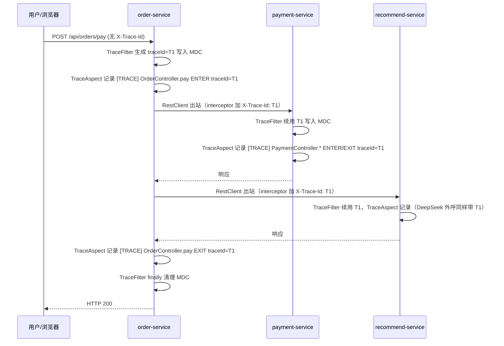

# 动态埋点（链路追踪）设计

> 波 1-B：零业务侵入的轻量分布式追踪 —— 统一 traceId 贯穿 5 个微服务，`[TRACE]` 前缀 entry/exit 日志 + `X-Trace-Id` 跨服务传播。
> 适用范围：product / order / payment / recommend / consult 五个服务 + 共享库 mall-common。

---

## 1. 动机

商城是 5 个独立微服务（商品 / 订单 / 支付 / 推荐 / 在线问诊），一次用户操作会跨 2~3 个服务。问题：

- **排查难**：每个服务各打各的日志，一次请求在 5 份日志里无从串起，只能靠时间窗猜。
- **无调用链**：无法回答"这个订单号经历了哪几个服务、每段耗时多少、哪一段最慢/失败"。
- **侵入风险**：在业务代码里手工传 traceId 会污染几十个方法签名，维护成本高。

方案目标：**零业务侵入**——不改任何 Controller / Service 的业务代码，通过 AOP + Servlet Filter + RestClient 拦截器统一织入，靠 SLF4J MDC 把 traceId 带进每行日志。

## 2. 总体设计

```
┌──────────────────────────────────────────────────────────────────────────┐
│                            mall-common（共享库）                            │
│                                                                            │
│  com.example.mall.common.trace                                             │
│   ├── TraceContext         静态 MDC 助手 + 传播拦截器工厂                    │
│   ├── TraceFilter          OncePerRequestFilter：入站解析 X-Trace-Id → MDC  │
│   ├── TraceAspect          @Aspect：@RestController/@Service 方法 ENTER/EXIT │
│   └── TraceAutoConfiguration  AutoConfiguration：注册 Filter + Aspect Bean   │
│                                                                            │
│  注册方式：META-INF/spring/org.springframework.boot.autoconfigure.           │
│            AutoConfiguration.imports  →  FQN 一行                           │
└──────────────────────────────────────────────────────────────────────────┘
            依赖
   ┌───────────────────────────────────────────────┐
   │ 5 个服务（compile 依赖 mall-common）            │
   │  ├─ 自动获得 TraceFilter / TraceAspect Bean    │
   │  └─ 3 处 RestClient 构建点加 1 行传播拦截器      │
   └───────────────────────────────────────────────┘
```

traceId 生命周期：
1. **入站**：`TraceFilter` 读请求头 `X-Trace-Id`（有则续用，无则生成 UUID 前 8 位），写入 MDC；请求结束 `finally` 清空。
2. **调用链内**：`TraceAspect` 对每个 `@RestController` / `@Service` 方法织入 ENTER / EXIT / ERROR 日志，从 MDC 取 traceId 内嵌进消息（独立 logger 名 `TRACE`，INFO 级）。
3. **出站**：各服务 RestClient 构建点挂 `TraceContext.interceptor()`，出站请求自动带 `X-Trace-Id`，下游 Filter 续用，形成一条完整的 trace。

## 3. 组件说明

### 3.1 TraceContext（静态工具类，`com.example.mall.common.trace`）

| 方法 | 职责 |
|---|---|
| `beginOrContinue(String headerValue)` | header 有值则 trim 后续用，否则生成 UUID 前 8 位；写入 `MDC.traceId` 并返回 |
| `getTraceId()` | 读当前线程 MDC |
| `clear()` | 移除 `MDC.traceId`（请求结束 / 线程复用防串线） |
| `propagate(ClientHttpRequest)` | MDC 有 traceId 则给请求加 `X-Trace-Id`，无则跳过 |
| `interceptor()` | 返回 `ClientHttpRequestInterceptor`，供 RestClient 构建点 `.requestInterceptor(TraceContext.interceptor())` 使用 |

常量：`MDC_KEY = "traceId"`、`TRACE_HEADER = "X-Trace-Id"`。

> 说明：`ClientHttpRequestInterceptor.intercept` 的首参是 `HttpRequest`（宽于 `ClientHttpRequest`），
> 方法引用 `TraceContext::propagate` 无法直接匹配，故统一用 `interceptor()` 工厂返回匿名拦截器，
> `propagate` 保留为语义一致的重载（单测覆盖）。

### 3.2 TraceFilter（入站 Filter）

- `extends OncePerRequestFilter`，**无构造参数**，零配置。
- `doFilterInternal`：读 `X-Trace-Id` → `beginOrContinue(...)` → `try { filterChain.doFilter } finally { clear() }`。
- 被 `TraceAutoConfiguration` 注册为普通 `Filter` Bean，Spring Boot 自动挂到 servlet 容器，全部 REST 接口生效。
- 无需显式跳过 `/actuator` / 静态资源：这些路径进入时若带 traceId 也只会正常记录，无副作用。

### 3.3 TraceAspect（AOP 埋点切面）

- 注解：`@Aspect` + `@Order(Ordered.HIGHEST_PRECEDENCE)`，**不标 @Component**，由 AutoConfiguration 注册为 `@Bean`。
- 切点：`@within(@RestController) || @within(@Service)`，覆盖所有 Controller / Service 的方法级 join point。
- 独立 logger `LoggerFactory.getLogger("TRACE")`，INFO 级，消息内内嵌 traceId。
- 成功/异常均记耗时；**异常记录后原样重抛（`throw t`），绝不吞异常**，业务事务与错误处理不受影响。
- traceId 为空（WS 线程等未走 Filter）记为 `-`。

### 3.4 TraceAutoConfiguration

- `@AutoConfiguration`（Spring Boot 3.5 自动装配注解），声明 `@Bean TraceFilter`、`@Bean TraceAspect`。
- 依赖 `META-INF/spring/org.springframework.boot.autoconfigure.AutoConfiguration.imports` 声明 FQN 被各服务加载。

## 4. 为什么必须用 `AutoConfiguration.imports`（兄弟包扫描问题）

`@SpringBootApplication` 默认组件扫描根包是各服务的**应用包**，例如 order-service 的
`com.example.mall.orderservice`、product-service 的 `com.example.mall.productservice`。

而 mall-common 的根包是 **`com.example.mall.common`** —— 它是各服务扫描根包的**兄弟包**，**不满足**父包-子包包含关系：

```
com.example.mall
 ├── common            ← mall-common（兄弟包）
 ├── orderservice      ← order-service 扫描根包
 ├── paymentservice    ← payment-service 扫描根包
 └── ...
```

因此 mall-common 里用 `@Component` / `@Configuration` 的 Bean **默认不会被任何服务拾取**。

解决：采用 Spring Boot 的 **AutoConfiguration 机制**。`@AutoConfiguration` 类不依赖组件扫描，
由 `AutoConfigurationImportSelector` 通过读取 classpath 上所有
`META-INF/spring/org.springframework.boot.autoconfigure.AutoConfiguration.imports` 文件加载。
mall-common 被各服务 compile 依赖，其 jar 内的 imports 文件必然在 classpath 上，于是每个服务启动时都会自动注册
`TraceFilter` / `TraceAspect`。

## 5. 跨服务传播时序（MDC + X-Trace-Id）



要点：
- traceId 从入口生成一次，靠 HTTP 头 + MDC 一路贯穿，日志行内嵌 traceId。
- 任一线程只要 MDC 有 traceId，AOP 日志和出站请求就自动带上，无需业务代码参与。
- WS（WebSocket）线程不经 HTTP Filter，无 traceId，日志记为 `-`（不阻断功能）。

## 6. AOP 切点清单

| 目标 | 切点表达式 | 说明 |
|---|---|---|
| 所有 REST 控制器 | `@within(org.springframework.web.bind.annotation.RestController)` | Controller 方法 ENTER/EXIT/ERROR |
| 所有业务服务 | `@within(org.springframework.stereotype.Service)` | Service 方法（含事务方法，切面最高优先级最外层） |

被 `@Aspect` 注解且由 Spring 管理的 Bean（aspectjweaver 在 classpath 上，由 `spring-boot-starter-aop` 提供）即被自动织入，代理方式为 CGLIB（无接口冲突）。

## 7. 日志行格式示例

日志来源 `LoggerFactory.getLogger("TRACE")`，INFO 级，消息内嵌 traceId：

```
# 进入
[TRACE] traceId=22fcf447 ConsultationController.accept() ENTER args=[Long:10, String:d1]
[TRACE] traceId=- PrescriptionService.prescribe() ENTER args=[WritePrescriptionRequest:com.example.mall.common.model.WritePrescriptionRequest@8da1aa0]

# 成功返回
[TRACE] traceId=22fcf447 ConsultationController.accept() EXIT elapsed=5ms result=com.example.mall.common.model.ConsultSessionDTO@2b3f7a68

# 异常（记录后原样重抛）
[TRACE] traceId=1939b60f OrderService.pay() ERROR ex=java.lang.IllegalStateException: xxx elapsed=12ms
```

安全摘要规则：
- 每个参数：`类型:值`（`String.valueOf`），截断 80 字符，逗号拼接。
- `args == null` 或长度 > 5：只记数量（如 `6 args`）。
- traceId 为空记 `-`。

提取链路：
```bash
# 5 个服务日志归集后，按 traceId 过滤即可得到一条完整调用链
grep '\[TRACE\]' service.log | grep 'traceId=22fcf447'
```

## 8. 改动文件清单

### mall-common（新增共享埋点能力）
- `mall-common/pom.xml`：新增 `spring-boot-starter-aop`（compile，传递到全部服务）、`spring-web`（compile，OncePerRequestFilter/ClientHttpRequestInterceptor）、`jakarta.servlet-api`（compile，spring-web 中为 provided 需显式声明）、`spring-boot-starter-test`（test，JUnit5 + spring-test）。
- `mall-common/src/main/java/com/example/mall/common/trace/TraceContext.java`（新增）
- `mall-common/src/main/java/com/example/mall/common/trace/TraceFilter.java`（新增）
- `mall-common/src/main/java/com/example/mall/common/trace/TraceAspect.java`（新增）
- `mall-common/src/main/java/com/example/mall/common/trace/TraceAutoConfiguration.java`（新增）
- `mall-common/src/main/resources/META-INF/spring/org.springframework.boot.autoconfigure.AutoConfiguration.imports`（新增，一行 FQN）
- `mall-common/src/test/java/com/example/mall/common/trace/TraceContextTest.java`（新增，6 用例）
- `mall-common/src/test/java/com/example/mall/common/trace/TraceFilterTest.java`（新增，2 用例）

### 三个 RestClient 构建点（各加一行 `.requestInterceptor(TraceContext.interceptor())`，其余超时/异常处理原样不动）
- `order-service/.../client/RestClientConfig.java`：`restClientBuilder()`（@Primary，覆盖 Product/Payment/Consult）与 `recommendRestClientBuilder()`（RecommendClient）两个 builder 都加。
- `payment-service/.../client/OrderClient.java`：构造器链。
- `recommend-service/.../ai/DeepSeekClient.java`：构造器链（外呼 AI，统一观察）。

### 文档
- `docs/trace/02-instrumentation-design.md`（本文档）。

未改动任何业务逻辑、其它测试与文档。

## 9. 回归测试结果

执行（仓库根，bash）：

```bash
export JAVA_HOME="D:\jdk25\jdk-25.0.2" && ./mvnw.cmd clean test
```

结果：**BUILD SUCCESS**，全绿。

| 模块 | Tests run | Failures | Errors | Skipped |
|---|---:|---:|---:|---:|
| mall-common（含新增 8 个埋点用例） | 8 | 0 | 0 | 0 |
| product-service | 45 | 0 | 0 | 0 |
| order-service | 105 | 0 | 0 | 0 |
| payment-service | 37 | 0 | 0 | 0 |
| recommend-service | 53 | 0 | 0 | 0 |
| consult-service | 116 | 0 | 0 | 0 |
| **合计** | **364** | **0** | **0** | **0** |

- 新增用例覆盖：header 有值续用 / 无值生成、MDC set/clear、`interceptor()` 有 traceId 加头 / 无 traceId 不加、`propagate` 逻辑、Filter 续用上游 traceId 且请求后清理、Filter 缺省生成新 traceId 且请求后清理。均不启动 Spring 上下文，毫秒级。
- 埋点为纯日志增强，不改任何业务行为；364 用例全绿即证明确实零业务侵入。

## 10. 遇到的问题与处理

1. **`clean` 阶段文件锁**：首次 `clean test` 在 product-service 报"无法删除 jar"——本机仍有 5 个微服务 + 根应用共 6 个 java 进程在运行，锁住了 `target/*.jar`。已临时结束这些运行实例（`taskkill //PID ... //F //T`），释放文件锁后 `clean test` 通过。服务后续可由 `start-services.cmd` 重启。
2. **recommend-service classpath URL check**：未出现；其 pom 中 surefire `argLine=-Djdk.net.URLClassPath.disableClassPathURLCheck=true` 配置本就在，无需处理。
