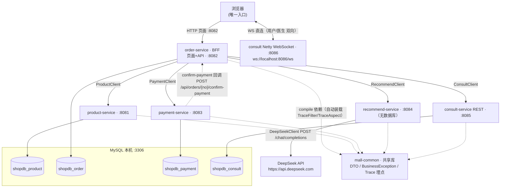
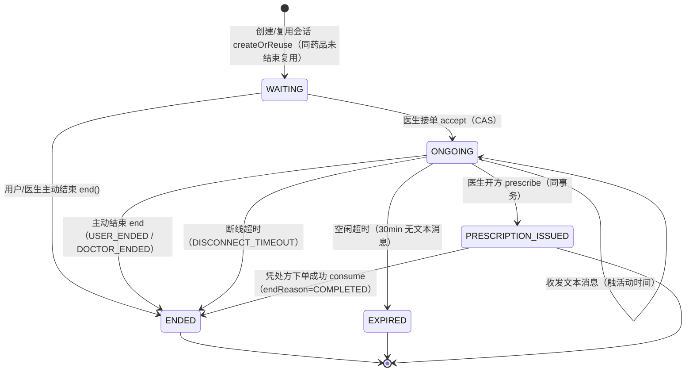
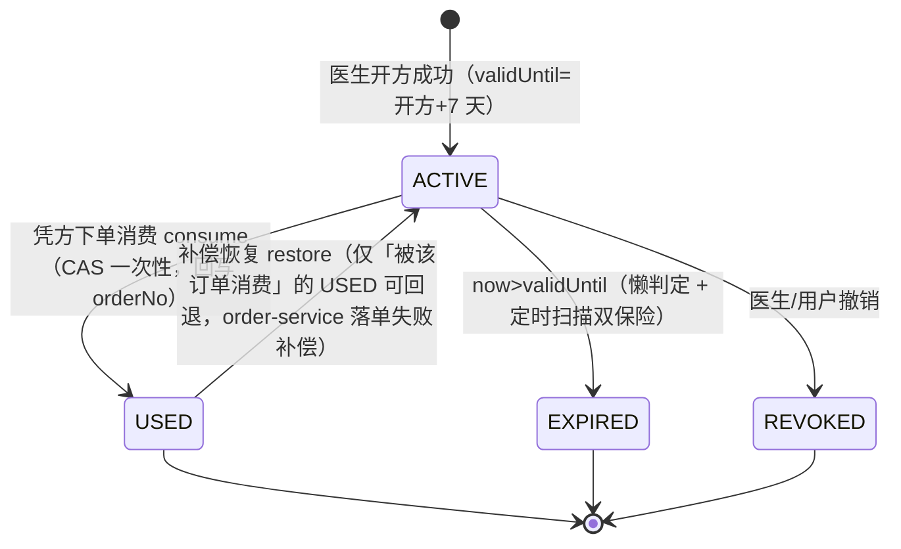

# 静态 + 动态结合流程图（波 3 综合出图）

> 波 3 综合出图：把 **01 静态知识图谱的调用链（`文件:行号`）** 与 **03 动态实测 trace（跨服务调用序列 + 耗时 ms + traceId）** 结合，
> 用 Mermaid 画出让新人一眼看懂「代码结构 + 业务逻辑」的流程图。
> 渲染：GitHub / VS Code（安装 Mermaid 插件）直接渲染。关联文档：`docs/trace/01-static-knowledge-graph.md`、`docs/trace/03-dynamic-traces.md`。
>
> **图例约定**：消息/节点上标注的耗时一律来自 03 动态实测（注明对应 GP 链路与 traceId）；无实测处标注「静态」，表示该路径来自 01 静态调用链分析、本轮未驱动。

---

## 0. 新人 5 分钟看懂本项目

一句话：这是一个 **BFF 单入口 + 四个后端微服务 + WS 在线问诊 + 处方购药** 的 Java 25 / Spring Boot 3.5.16 商城——
浏览器唯一入口是 **order-service(:8082)**，它聚合了 商品(:8081)/支付(:8083)/推荐(:8084，外呼 DeepSeek)/问诊(:8085 REST + :8086 WS 浏览器直连) 四个下游，
共享一个 **mall-common** 依赖库（DTO / 异常 / 动态埋点）。买普通药走「下单→支付→推荐」；买处方药（Rx）必须先「在线问诊→医生开方→凭方购药」，处方一次性消费、不可复用。

---

## 1. 系统架构图



**说明**（为什么这样设计 / 关键文件在哪 / 动态实测注意点）：
- **BFF 单入口**：所有页面（商品列表/详情/确认/下单/支付/支付成功/订单详情）都在 order-service 的 `ShopController`（`order-service/web/ShopController.java:33`）与 `ConsultController`；商品/支付/推荐/问诊数据一律经 RestClient 转发下游，浏览器不直接调下游 REST，隔离了服务变更对前端的冲击。
- **四库独立**：product/order/payment/consult 各持一库（`init.sql:9-12`），**recommend-service 无数据库**（纯计算 + 外呼 AI）。跨服务一致性靠「回调（支付确认）」与「Saga 补偿（下单）」两条路径，不做分布式事务。
- **WS 与 REST 分端口**：Tomcat 无法与 Netty 共端口（`consult-service/netty/WsServer.java:16`），故 REST 走 :8085、WS 走 :8086；WS 握手路径 `/ws`（`netty/WsPipelineInitializer.java:35`）。
- **动态注意**：健康检查不能对无根映射的服务发 `GET /`（返回 500 属正常），用真实 API（如 `GET /api/products`）探测（03 §1）。WS 帧走 Netty 事件循环线程、不经 TraceFilter，`traceId=-`（03 §7）。

---

## 2. 黄金链路时序图（4 张）

### 2.1 下单（含 Rx 处方药 + Saga 补偿）

```mermaid
sequenceDiagram
    participant B as 浏览器
    participant O as order-service
    participant P as product-service
    participant C as consult-service

    B->>O: POST /order（productId,quantity[,prescriptionNo]）
    O->>P: GET /api/products/{id}（价格/库存预检）
    Note over P: 动态：getProduct 3ms（GP1/GP4 预检段）
    P-->>O: ProductDTO
    O->>P: POST /api/products/{id}/stock/deduct（原子扣减）
    Note over P: 单条 UPDATE WHERE stock>=qty 防超卖;<br/>动态：deductStock 68ms（GP1）/ 49ms（GP4）
    P-->>O: 扣减成功
    opt Rx 处方药（静态链 + GP4 实测）
        O->>C: POST /api/consult/prescriptions/consume（no,orderNo,items）
        Note over C: CAS 一次性 USED 防复用;<br/>动态：consume 51ms（GP4）
        C-->>O: PrescriptionDTO(USED)
    end
    O->>O: 本地落单 + 明细快照
    Note over O: 动态：createOrder 共 219ms（GP1）/ 217ms（GP4）<br/>失败补偿（Saga）:<br/>扣库存成功但消费失败→restoreStock;<br/>落单失败→restorePrescription(USED→ACTIVE)+restoreStock
    O-->>B: 302 → /order/SO…
```

**说明**：
- **执行顺序**：先扣库存 → Rx 再消费处方 → 最后本地落单（`order-service/service/OrderService.java:95`）。库存校验在上游只是提示，**原子扣减是并发唯一边界**（`product-service/service/ProductService.java:38` + `repository/ProductRepository.java:20`）。
- **fail-closed**：Rx 商品缺 prescriptionNo 直接拒绝下单（`OrderService.java:120-125`）；问诊服务不可用也拒绝 Rx（`order-service/client/ConsultClient.java:29-31`），绝不放行无处方购药。
- **动态注意**：扣库存是事务写，GP1 达 68ms（下单全链路最慢段）；GP4 中 `deductStock 49ms + consume 51ms` 均为同一量级（50~70ms 写路径特征，03 §8.3）。补偿路径本轮未触发，属**静态链**。

### 2.2 支付（PROCESSING → 回调 → SUCCESS）

```mermaid
sequenceDiagram
    participant B as 浏览器
    participant O as order-service
    participant P as payment-service

    B->>O: POST /order/{orderNo}/pay
    O->>P: POST /api/payments（executePayment）
    P->>O: GET /api/orders/{orderNo}（支付前校验订单）
    Note over O: 动态：getOrderDTO 227ms（GP2 最慢段，读订单+明细）
    O-->>P: OrderDTO(CREATED)
    P->>P: saveAndFlush 落流水置 PROCESSING
    P->>O: POST /api/orders/{orderNo}/confirm-payment
    Note over O: 幂等：CREATED→PAID（已 PAID 直接成功）;<br/>动态：confirmPayment 29ms（GP2）
    O-->>P: OrderDTO(PAID)
    Note over P: 动态：executePayment 共 591ms（GP2）;<br/>回调失败→流水置 FAILED 并上抛（不卡 PROCESSING）
    P-->>O: PaymentDTO(SUCCESS)
    O-->>B: 302 → /order/{no}/pay/success
```

**说明**：
- **职责边界**：payment-service 只落流水 + 回调，订单状态变更永远由 order-service 自己完成（`payment-service/service/PaymentService.java:40` → `order-service/service/OrderService.java:268` 幂等 `confirmPayment`）。
- **防重复**：同一订单只允许一条流水（`PaymentService.java:63-91`），FAILED 可复用该行重试，避免 `order_no` 唯一约束阻断「失败重试」。
- **动态注意**：GP2 最慢段是**支付前拉单** `getOrderDTO 227ms`（订单+明细懒加载往返），而非模拟扣款；`executePayment` 591ms 中两次对 order 的回调合计约 256ms（03 §8.2）。该耗时为单次冷启动量级，同 GP1 的写路径特征一致。

### 2.3 推荐（AI → 规则 → 降级）

```mermaid
sequenceDiagram
    participant B as 浏览器
    participant O as order-service
    participant P as product-service
    participant R as recommend-service
    participant D as DeepSeek API

    B->>O: GET /order/{orderNo}（订单详情页）
    O->>O: 查订单 + 明细
    Note over O: 动态：findOrderByOrderNo 52ms + listOrderItems 4ms（GP3）
    O->>P: GET /api/products（全量目录）
    Note over P: 动态：listProducts 38~40ms（GP3）
    P-->>O: 目录 catalog
    O->>R: POST /api/recommendations（type=similar）
    R->>R: ① AI 优先 recommendSimilar
    opt 配置了 deepseek.api-key（本轮未配置）
        R->>D: POST /chat/completions（携带 traceId）
        D-->>R: 推荐 JSON（三层校验）
    end
    Note over R: 动态：AI 返回空 1ms（未配 Key→不外呼）;<br/>本轮未观测到外呼（03 §8.4）
    R->>R: ② 规则补足 topN=4
    Note over R: 动态：RuleRecommendationService 6ms;<br/>recommend 共 11~14ms（GP3）
    R-->>O: 推荐结果（source=ai/rule）
    O-->>B: 页面 200（动态：整页 ~413ms）
```

**说明**：
- **编排策略**：AI 优先、不足 topN 用规则补足、任一异常吞掉回退、绝不 500（`recommend-service/service/RecommendationService.java:43`）。容错边界在 order 侧 `RecommendClient`（`order-service/client/RecommendClient.java:62-65`）——推荐服务不可用只记日志返回空列表，页面区块 `th:if` 隐藏。
- **降级超时**：支付成功页两次推荐**并行** `CompletableFuture` + `orTimeout(2s)`，超时降级空列表，保证页面渲染 ≤3s（`order-service/web/ShopController.java:175-182`）。
- **动态注意**：本轮 `deepseek.api-key` 为空 → `AiRecommendationService` 直接返回空（1ms），**未发生真实外呼**，推荐全走规则（6ms）；「AI 外呼慢」未在本轮出现，配置 Key 后重跑 GP3 方可观测（03 §8.4）。DeepSeek 外呼链路（`ai/DeepSeekClient.java:51` → `POST /chat/completions`）为**静态链**。

### 2.4 问诊 + 处方购药（会话/WS/接诊/开方/凭方购药）

```mermaid
sequenceDiagram
    participant B as 浏览器（用户/医生）
    participant O as order-service
    participant C as consult REST :8085
    participant W as consult WS :8086
    participant P as product-service

    Note over B,C: ① 创建会话
    B->>O: POST /api/orders/consult/sessions {productId}
    O->>C: POST /api/consult/sessions
    Note over C: 动态：createOrReuse 570ms（GP4 冷启动最慢段）;<br/>签用户 WS token + 预加载内存态 SessionState
    C-->>O: sessionId + token（WAITING）
    O-->>B: token

    Note over B,W: ② WS 实时聊天（browser 直连 :8086）
    B->>W: join(sessionId, token)
    W-->>B: joined(WAITING, lastSeq)
    B->>W: message「您好，我咳嗽三天了」
    Note over W: 事件循环线程，traceId=-;<br/>动态：sendTextMessage 11ms（入批量写队列零阻塞）
    W-->>B: ack(seq=1)
    Note over B,W: WS 帧不经 TraceFilter→traceId=-（03 §7）

    Note over B,C: ③ 医生接单
    B->>C: POST /api/consult/sessions/{id}/accept
    Note over C: 动态：accept 80ms（CAS WAITING→ONGOING + 签医生 token）
    C-->>B: 医生 token（ONGOING）

    Note over B,C: ④ 医生开方
    B->>C: POST /api/consult/prescriptions
    Note over C: 动态：prescribe 97ms（同事务 处方 INSERT + ONGOING→PRESCRIPTION_ISSUED）;<br/>终态收尾 finalizeTerminal 18ms
    C-->>B: 处方 RX2026…（ACTIVE）

    Note over B,O: ⑤ 凭处方下单购药
    B->>O: POST /order（prescriptionNo=RX…）
    O->>P: POST /api/products/{id}/stock/deduct
    Note over P: 动态：deductStock 49ms（GP4）
    P-->>O: 扣减成功
    O->>C: POST /api/consult/prescriptions/consume
    Note over C: 动态：consume 51ms（CAS 一次性 USED）;<br/>会话 PRESCRIPTION_ISSUED→ENDED(COMPLETED)
    C-->>O: PrescriptionDTO(USED)
    O->>O: 本地落单（动态：createOrder 共 217ms）
    O-->>B: 302 → /order/SO…
```

**说明**：
- **BFF 转发 + 索引**：建会话/开方/查消息/查处方都经 order-service 的 `OrderApiController`（`order-service/api/OrderApiController.java:59-85`）转发，并登记 BFF 内存索引 `ConsultSessionIndex` 供医生工作台/聊天页使用；WS token 也由 order 侧 `ConsultClient.createSession` 签发。
- **事件循环零阻塞**：WS 帧在 `WsFrameHandler.channelRead0`（`consult-service/netty/WsFrameHandler.java:78`）内只做「校验→分配 seq→入批量写队列」，落库由 `MessageWriteQueue` 异步批量执行，`sendTextMessage` 实测仅 0~11ms（ADR-IM-04）；开方/结束则卸载到独立执行器（`WsFrameHandler.java:163` / `:200`）。
- **动态注意**：① 创建会话 570ms 是 **GP4 冷启动最慢段**（建会话+签 token+预加载内存态+`MAX(seq)` 查询含 JPA 首查编译），后续同类操作回落到 ~10ms 级（03 §8.1）；② WS 帧 traceId=- 为设计预期（不经 Servlet Filter，03 §7）；③ 处方药品实测为 **id=32「阿莫西林胶囊」**（非任务预估 id=9，03 §9）。

---

## 3. 状态机图（2 张）

### 3.1 问诊会话状态机



**说明**（`mall-common/model/ConsultationStatus.java:12`、`consult-service/service/`）：
- **终态三**：`PRESCRIPTION_ISSUED / ENDED / EXPIRED` 只读，拒绝发消息/开方/接诊（`ConsultationStatus.isTerminal()`）；内存态与 DB 全部走 CAS 影响行数裁决，DB 为唯一权威（`repository/ConsultationSessionRepository.java`）。
- **endReason 五种结束方式**：`USER_ENDED`（用户主动，end 接口缺省/WS 用户 end 帧）、`DOCTOR_ENDED`（医生主动，WS 医生 end 帧）、`DISCONNECT_TIMEOUT`（断线缓冲 60s 超时，调度器 `SessionEndScheduler`）、`COMPLETED`（处方消费成功自动结束，`PrescriptionService.consume:143`）、开方完成即终态 `PRESCRIPTION_ISSUED`（`doPrescribe` 同事务置终态，随后被消费才转 ENDED/COMPLETED）。
- **WAITING 防误判**：空闲超时扫描**只对 ONGOING 计时**（`repository/ConsultationSessionRepository.java:28` 查询条件只查 ONGOING），WAITING 会话（用户挂机等医生）**不会被自动过期**；断线缓冲以内存态离线时刻判定，且 join 在会话锁内「关旧绑新」接管，重连成功即清断线标记（`WsFrameHandler.handleJoin:111` / `SessionLifecycle.onDisconnect:173`）——避免缓冲期内重连被误判结束。

### 3.2 处方状态机



**说明**（`mall-common/model/PrescriptionStatus.java:11`、`consult-service/service/PrescriptionService.java`）：
- **一次性消费**：`consume` 用单条 `CAS UPDATE` 把 `ACTIVE→USED` 并回写 `consumedOrderNo`，影响行数为 0 即重复消费失败（`PrescriptionService.java:143`，防复用靠 DB 行锁串行化）；**消费必须携带 orderNo**（P1-02 契约），补偿 `restore` 也只允许被该订单消费的处方 `USED→ACTIVE`（`PrescriptionService.java:189`）。
- **过期双保险**：查询/消费时懒判定（now>validUntil 实时置 EXPIRED，`PrescriptionService.lazyExpireIfNeeded:228`）+ 调度器每 60s 定时扫描（`SessionEndScheduler.sweepPrescriptionExpiry:89`）。
- **动态注意**：GP4 实测消费 `consume 51ms`（事务写，与扣库存同一量级）；处方 `RX202608121710129086` 消费后为 `USED(consumedOrderNo=SO…)`、会话 `ENDED(COMPLETED)`（03 §5.5）。REVOKED / EXPIRED 路径本轮未驱动，属**静态链**。

---

## 4. 动静态结合方法与注意点

| 项 | 说明 |
|---|---|
| **骨架** | 4 条时序图以 01 静态调用链为骨架（参与方、跨服务 HTTP 契约、`文件:行号`），保证结构准确、可回溯源码 |
| **血肉** | 03 动态实测的耗时/成败/traceId 标注到对应消息上（如 `deductStock 68ms`、`executePayment 591ms`、`consume 51ms`、`prescribe 97ms`），让「哪一段最慢」一眼可见 |
| **未实测标「静态」** | 补偿（restoreStock/restorePrescription）、DeepSeek 外呼、REVOKED/EXPIRED 等本轮未驱动的路径均显式标注「静态」，不夸大（03 §8.4） |
| **traceId 连续性** | gp1-order → product；gp2-pay → payment → order（两段回调同 id）；gp3-recommend → product/recommend；gp4-consult → product/consult（create/consume）均完整；WS 帧 traceId=-（03 §6） |
| **渲染** | 各 Mermaid 块在 GitHub / VS Code 直接渲染；如需修改，改源文件即可，勿直接编辑渲染图 |
| **一键重跑** | 复现动态 trace：`run.cmd` 启动 5 服务后，按 03 文档 §2~5 的 curl（中文 body 用 python `ensure_ascii=True`）驱动，再 `grep '[TRACE]' logs/*.log | grep traceId=xxx` 串联 |
